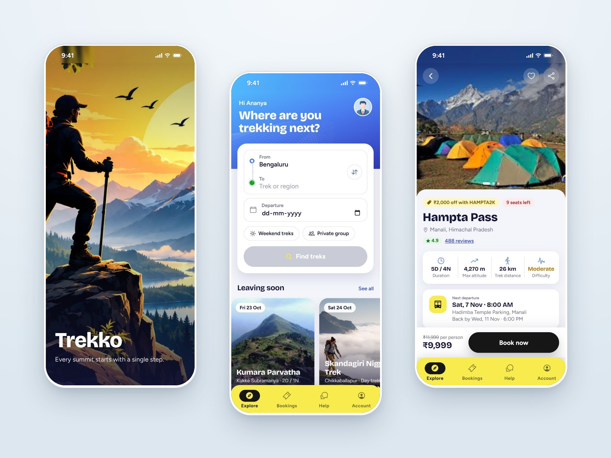
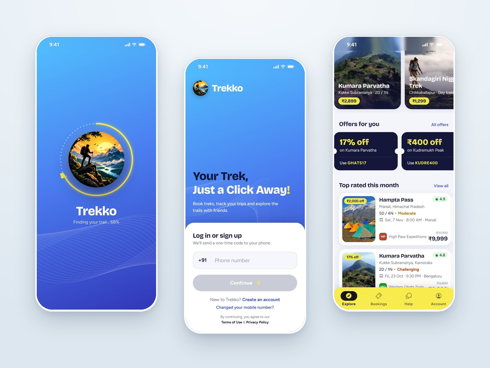

<p align="center">
  
</p>

<h1 align="center">Trekko</h1>

<p align="center">
  Find a trek, check what's included, book your seat and keep every ticket in one place.
</p>

<p align="center">
  
  
  
  
  
</p>

<p align="center">
  
</p>

## Why I built this

Booking a weekend trek from Bengaluru usually means jumping between WhatsApp
groups, Instagram pages and spreadsheets from different organisers. You never
quite know what's included, where the bus leaves from, or how many seats are
left.

Trekko is my attempt at fixing that: one app where you can compare treks and
organisers side by side, see the full route and itinerary, and book in a
couple of taps. It's a mobile app built with Ionic and Angular, and it runs
on Android, iOS and the web from the same code.

## What you can do in the app

**Find a trek**
- Search by where you're starting from, where you want to go and when.
- Filter for weekend treks or private groups, and sort by price, rating or
  departure date.
- Browse treks leaving soon, current offers and top-rated treks.
- Check trail weather before you go.

**Look before you book**
- Every trek has a photo gallery, distance, altitude, difficulty and the
  operator running it.
- A step-by-step route, from the pickup point to the summit and back.
- Day-by-day itinerary, what's included and what isn't, where you'll stay,
  reviews from other trekkers and the cancellation policy.
- Share a trek with friends over WhatsApp, Telegram or a link.

**Book it**
- Add travellers, contact details and optional add-ons such as free
  cancellation and trek insurance, with the total updating as you go.
- Apply a coupon, see the full price breakdown and pay with UPI or a card.
  Seats are held for 10 minutes while you pay.

**After booking**
- My Bookings shows upcoming, completed and cancelled trips, with a countdown
  to your next trek.
- Each ticket has the pickup point, reporting time, seats and directions.
- Help has searchable FAQs, call and WhatsApp support, and a form to raise a
  request about a booking.

<p align="center">
  
</p>

## A note on the data

Right now the app runs on sample data (`src/app/shared/mock-data.ts`): six
treks, five operators, bookings, reviews and weather. Payments are simulated
and nothing is charged. Login and sign-up are wired to API endpoints, but the
backend isn't part of this repository.

Keeping all the sample data in one file means connecting a real API later is
mostly a matter of swapping that file for service calls.

## Tech stack

| | |
|---|---|
| Framework | Angular 18 with Ionic 8 |
| Native | Capacitor 6 (Android and iOS) |
| Language | TypeScript, SCSS |
| Icons | Ionicons |
| Fonts | Bricolage Grotesque and Figtree |
| Tests | Jasmine and Karma |

The design system lives in `src/global.scss`: colour tokens, type, buttons,
form fields, the shared trek card and the motion rules. Animations respect the
phone's "reduce motion" setting.

## Running it locally

You'll need Node.js 18.19 or newer (20 or 22 recommended) and npm.

```bash
git clone https://github.com/PaVaN1063/Trekko.git
cd Trekko
npm install
npm start
```

Then open http://localhost:4200. If you have the Ionic CLI installed,
`ionic serve` works too and opens on port 8100.

To try it in a phone-sized window, open your browser's developer tools and
switch on device mode.

### Android and iOS

```bash
npm run build
npx cap sync android   # or: npx cap sync ios
npx cap open android   # or: npx cap open ios
```

Android needs Android Studio. iOS needs a Mac with Xcode.

### Other commands

| Command | What it does |
|---|---|
| `npm start` | Starts the dev server |
| `npm run build` | Production build into `www/` |
| `npm test` | Unit tests with Karma |
| `npm run lint` | Lint checks |

## Project structure

```text
src/
├── app/
│   ├── Components/      # Splash, login, sign-up and account recovery
│   ├── Home/            # Explore, trek lists, trek details, booking and payment
│   ├── MyBookings/      # Tickets
│   ├── Help/            # Support
│   ├── Account/         # Profile and About
│   ├── tabs/            # Bottom tab bar
│   └── shared/          # Header, trek card, trek list, logo, mock data
├── assets/
│   ├── brand/           # Trekko logo and artwork
│   └── images/          # Trek photos
└── global.scss          # Design system
docs/screenshots/        # Images used in this README
```

## What's next

- Connect the real backend for login, treks and bookings
- Verify OTP on the server before logging in
- Real payment gateway
- Saved treks and trek reminders
- Trail map with live location on trek day

## Copyright

© 2026 Pavan Kumar Naraharisetti. All rights reserved.

The code is public so that anyone can see how the app is built. The code,
design, the Trekko name and the logo may not be copied, reused or published
without my written permission. See [LICENSE](LICENSE) for details.

Trek photos, organiser names and people in the app are sample content for
demonstration only.

If you'd like to use something from this project or work on it together,
reach out on [GitHub](https://github.com/PaVaN1063).
